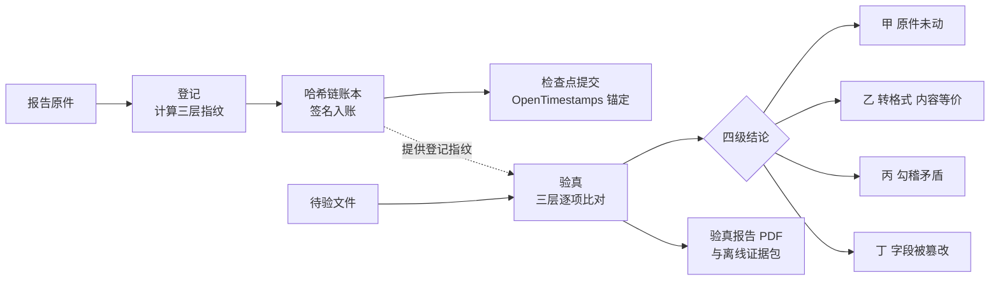

<div align="center">

# 数玺 Shuxi

**给每一份报告一枚改不了、查得清的电子印章**

报告发出去之前先「盖个章」，日后任何人拿到这份报告，都能当场验出它有没有被改过一个字。

[](https://shuxi-seal.streamlit.app)
[](https://www.python.org/)
[](tests/)
[](eval/REPORT.md)

[在线演示](https://shuxi-seal.streamlit.app) · [快速开始](#快速开始) · [部署方式](#部署方式) · [实测数据](#实测数据) · [离线复核](#离线复核)

</div>

---

## 它解决什么问题

检测报告、审计报告、评估报告这类文件有个老毛病：

- **真报告被误杀**：报告转个格式、打印后重新扫描，文件字节就变了。传统单哈希校验只认字节，一变就报「不一致」，真报告反倒过不了。
- **假报告查不出**：只改其中一个关键数字，别处全不动。肉眼看不出，单哈希只能说「文件变了」，说不清改在哪、改的是什么。

数玺的做法是给报告做**三层指纹**存档，验真时分**四级下结论**：原件未动、转格式但内容等价、内部数字互相矛盾、关键字段被篡改，四种情况分得清清楚楚，被改的字段逐个定位。

## 在线演示

**https://shuxi-seal.streamlit.app**

进入后点侧栏「一键载入演示数据」，再点「评委导览 · 一键连跑」，登记、篡改验真、随手查、证据包导出四步会自动连跑一遍，一分钟看完全部核心链路。

## 核心能力

- **三层指纹登记**：字节层（SHA-256 与国密 SM3 双哈希 Merkle 树）、版式层（页面感知哈希与文本相似度）、字段层（关键字段加盐 Merkle 树），一次登记，三重存档。
- **四级分级验真**：甲（原件未动）、乙（转格式、内容等价）、丙（内容对得上但内部勾稽矛盾）、丁（关键字段被改，逐字段定位），外加把握不足时转人工复核。每一级都附把握程度与可展开的底层证据。
- **勾稽规则引擎**：报告内部数字之间的关系（分项之和等于总计之类）由配置文件驱动校验，规则可增删，不动代码。
- **记名授权与账本**：授权按对象记名，限期、限次，全程写入哈希链账本，条目带 Ed25519 签名；凭证作废由登记方签名执行，不可逆。
- **外部时间锚定**：账本检查点提交 OpenTimestamps 公共日历，待比特币网络确认后完成锚定。账本不自证，任何人都能用公开工具独立核验。
- **单个字段选择性披露与范围证明**：可以只出示报告中的一个字段并证明它没被改过，也可以证明某个数值落在登记时承诺的区间内，全程不暴露报告原文与其它字段。
- **多方门限共签**：账本检查点可由存证方、核验方、公证方多方各自持钥签署，达到门限才生效，任何一方单独改不了账。
- **红蓝对抗沙盒**：选定一份已登记报告，现场注入改数字、换页等攻击并立即穿透验真，检出效果当场可见。
- **随手查初判**：没登记过的文件不选凭证也能先初判一遍，并精确反查是否为已登记原件。
- **验真报告与证据包**：每次正式验真生成可打印存档的 PDF 报告，并可导出自包含证据包，断网用仓库内脚本复核出同一结论。

## 工作原理



| 指纹层 | 存的是什么 | 回答的问题 |
|---|---|---|
| 字节层 | 文件字节的 SHA-256 与 SM3 双哈希 Merkle 根 | 这份文件一个字节都没动过吗 |
| 版式层 | 每页的感知哈希与文本相似度 | 转格式、重扫描之后，版面与文字还是原来那样吗 |
| 字段层 | 关键字段的加盐 Merkle 根 | 报告里的关键数字，一个都没被改吗 |

| 验真结论 | 含义 | 把握程度 |
|---|---|---|
| 甲级 | 原件未动，字节级完全一致 | 0.99 |
| 乙级 | 转过格式或重新扫描，内容等价 | 0.75 至 0.90 |
| 丙级 | 数字与原件一致，但内部勾稽关系对不上 | 0.85 |
| 丁级 | 关键字段被改，逐字段定位差异 | 0.95 |
| 待人工复核 | 证据不足以下结论，转人工 | 0.40 |

## 快速开始

环境要求：Python 3.11 或更高版本，磁盘约 1.5 GB，内存 2 GB 以上。只有第一次安装依赖需要联网，装好之后可以完全离线运行。

```bash
git clone https://github.com/CityMeng/shuxi.git
cd shuxi
python3 -m venv .venv
.venv/bin/pip install -r requirements.txt
bash run.sh
```

浏览器打开 http://localhost:8501 ，点侧栏「一键载入演示数据」即可开始体验。

也可以不用脚本，直接启动：

```bash
.venv/bin/streamlit run app.py
```

Windows 下把 `.venv/bin/` 换成 `.venv\Scripts\` 即可。

## 部署方式

### 方式一：Streamlit Community Cloud（在线演示站用的就是这个）

1. 把本仓库 Fork 到自己的 GitHub 账号，或直接使用本仓库。
2. 打开 [share.streamlit.io](https://share.streamlit.io)，用 GitHub 账号登录，点「New app」。
3. 仓库选 `shuxi`，分支选 `main`，主文件路径填 `app.py`。
4. 点「Deploy」，等待依赖安装完成即可访问，得到一个公开网址。

说明：`requirements.txt` 里的 Python 依赖与 `packages.txt` 里的系统依赖（中文字体，验真报告 PDF 排版要用）都会在部署时自动安装，不用额外配置。免费层在闲置一段时间后会休眠，下一个访问者打开时自动唤醒，等待几十秒即可。免费层数据不持久化，应用重启后账本会重置，适合演示与体验。

### 方式二：自己的服务器或本地长期运行

```bash
git clone https://github.com/CityMeng/shuxi.git
cd shuxi
python3 -m venv .venv
.venv/bin/pip install -r requirements.txt
.venv/bin/streamlit run app.py --server.port 8501
```

任何能跑 Python 3.11 以上版本的 Linux、macOS、Windows 机器都可以。需要对外提供访问时，在前面加一层反向代理即可，应用本身不依赖任何外部数据库或第三方服务。

数据默认存放在项目下的 `data/` 目录，可用环境变量 `SHUXI_DATA_DIR` 改到其它位置：

```bash
SHUXI_DATA_DIR=/srv/shuxi-data .venv/bin/streamlit run app.py
```

### 方式三：一键脚本

已经建好虚拟环境并装好依赖的前提下：

```bash
bash run.sh
```

## 实测数据

所有数字来自仓库内公开的评测报告与测试脚本，任何人都可以复跑核对。

**自动化测试：六套共 174 项，全部通过**

| 套件 | 项数 | 内容 |
|---|---|---|
| 标准向量 | 55 | 指纹算法与公开标准向量逐位核对 |
| 场景测试 | 44 | 登记、验真、授权、作废全流程场景 |
| 界面测试 | 24 | 三个页面的交互与导览 |
| 扩展测试 | 20 | 锚定、证据包、报告生成 |
| 深度加固 | 23 | 范围证明、门限共签、规则引擎、沙盒 |
| 残留纠错 | 8 | 历史问题回归 |

复跑命令见仓库 `vectors/` 与 `tests/` 目录下各脚本。

**合成语料盲测：308 例（评测报告：[eval/REPORT.md](eval/REPORT.md)）**

| 指标 | 数玺 | 行业单哈希基线 |
|---|---|---|
| 总准确率 | 95.13%（293/308） | 50.65% |
| 篡改检出率 | 100% | 不适用（二值判定） |
| 内容等价召回 | 0.9013（137/152） | 0（等价类全部误判） |

**真实语料验证：6 份上市公司法定披露报告，24 例（评测报告：[eval/REPORT_REAL.md](eval/REPORT_REAL.md)）**

判对 23 例（95.83%），基线 50%。漏判的 1 例是裸数字篡改，原因已在报告中如实列明，没有藏。

**已知短板，如实说明**

合成集里扫描子类准确率为 37.5%（9/24）。失败全部落在判严的一侧：扫描时的倾斜与噪点干扰了版式指纹比对，系统认不准时宁可判严、转人工复核，也绝不放行，一份篡改件都没有漏过。真实报告重扫的 6 例全部判对。扫描路径升级已列入后续计划。

## 离线复核

验真结论不依赖平台在线服务。在系统里导出证据包（JSON）后，断网执行：

```bash
.venv/bin/python verify_bundle.py 证据包.json 待验文件.pdf
```

脚本会独立重算指纹、校验账本与锚定绑定，给出复核结论，并核对与证据包内报告结论是否一致。

## 项目结构

```text
shuxi/
├── app.py               界面与流程编排（登记 / 验真 / 授权与账本三页）
├── engine/              核心引擎
│   ├── fp.py            三层指纹计算
│   ├── grade.py         四级判定与把握度
│   ├── ledger.py        哈希链账本与签名
│   ├── service.py       登记、验真、授权业务服务
│   ├── anchor.py        OpenTimestamps 外部锚定
│   ├── bundle.py        证据包导出
│   ├── report_pdf.py    验真报告 PDF 生成
│   ├── zkp.py           字段范围证明
│   ├── cosign.py        多方门限共签
│   ├── dsl.py           勾稽规则引擎
│   └── sandbox.py       红蓝对抗沙盒
├── vectors/             标准测试向量、样例文件与核对脚本
├── tests/               场景、界面与加固测试
├── eval/                盲测语料、评测脚本与报告（REPORT.md / REPORT_REAL.md）
├── rules.json           勾稽规则配置（可直接改，改完即生效）
├── requirements.txt     Python 依赖（版本已冻结）
├── packages.txt         系统依赖（Streamlit Cloud 部署用）
├── run.sh               一键启动脚本
└── verify_bundle.py     证据包离线复核工具
```

## 隐私与安全说明

- 登记与验真比对的是指纹与字段摘要。验真方凭凭证即可核验，不需要把报告原文托管给平台。
- 本仓库为可运行的演示系统，其中的共签演示密钥是公开标注的演示密钥，只用于展示流程。正式部署时，各参与方须各自生成并保管自己的私钥。
- 在线演示站为免费层部署，数据不持久化，请不要在演示站登记真实敏感文件。

## 后续计划

- 机构版多账户与权限体系（机构、验真方、审计三类账户分离，私钥各归各家）
- 扫描路径专项升级，提高扫描件等价判定准确率
- 与检测机构开展试点，接入真实业务报告验证

## 反馈

发现判定错误或部署问题，欢迎在 [Issues](https://github.com/CityMeng/shuxi/issues) 里留下复现文件与步骤。判定逻辑的问题请附上证据包，方便离线复现。
